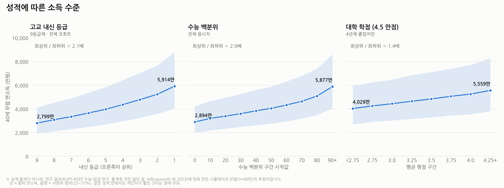
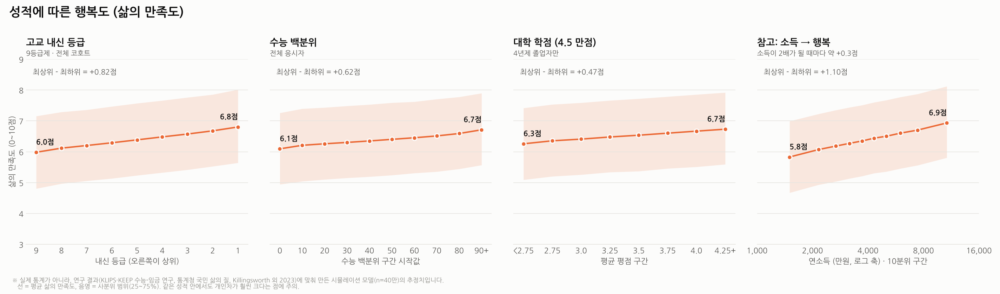

# 성적에 따른 소득 수준과 행복도

고교 내신 등급, 수능 백분위, 대학 학점(4.5 만점)에 따라 40세 무렵 연소득과 삶의 만족도가 어떻게 달라지는지 보여주는 그래프입니다.

> **주의:** 성적과 소득·행복을 한 번에 담은 공개 데이터는 없습니다. 아래 그래프는 실제 통계가 아닙니다.
> 연구 결과에 맞춰 만든 **시뮬레이션 모델(가상 코호트 40만 명)** 의 추정치입니다.

## 소득 수준



- 선은 구간별 **중위 연소득**, 음영은 **사분위 범위(25~75%)** 입니다.
- 내신·수능 최상위 구간의 중위 소득은 최하위 구간의 약 2배입니다. 학점 차이는 약 1.4배로 더 작습니다.
- 같은 성적 구간 안에서의 개인차(음영 폭)가 구간 간 차이보다 훨씬 큽니다.

## 행복도 (삶의 만족도)



- 선은 구간별 **평균 삶의 만족도(0~10점)**, 음영은 사분위 범위입니다.
- 최상위와 최하위 구간의 차이는 약 0.5~0.8점입니다. 최상위 구간도 7점을 넘지 않습니다.
- 오른쪽 참고 패널처럼 행복은 log(소득)에 비례해 완만하게 오릅니다. 소득이 2배가 되면 약 +0.3점입니다. 성적이 행복에 주는 영향은 대부분 소득을 거쳐 작게 전달됩니다.

## 모델 가정

| 항목 | 모델 설정 | 근거 |
|---|---|---|
| 잠재 요인 | 인지능력, 성실성, 가정 배경(SES) | — |
| 내신 | 성실성 비중이 큼, 9등급제 비율(4/11/23/40/60/77/89/96%) | 9등급 상대평가 |
| 수능 | 인지능력 비중이 큼 | — |
| 4년제 졸업 | 대략 상위 50%, 수능 상위일수록 대학 서열 프리미엄 | — |
| 소득 | 40세 무렵 중위 4,000만원, 로그정규 분포 | 통계청 임금 통계 수준 |
| 수능 → 소득 | 4년제 졸업자 안에서 1 표준편차당 약 +14% | KLIPS 연구 +7.3%, 해외 연구 10~18% 사이 |
| 학점 → 소득 | 상관계수 약 0.13 (작은 양의 관계) | GOMS 기반 연구, 해외 메타분석 |
| 삶의 만족도 | 평균 6.4점, log(소득)에 비례 | 통계청 「국민 삶의 질」, Killingsworth 외(2023) |

실행해서 나오는 모델 요약값:

```
r(내신, log소득) = 0.29    r(수능, log소득) = 0.35    r(학점, log소득 | 4년제) = 0.13
r(log소득, 만족도) = 0.18  r(수능, 만족도) = 0.10
```

## 실행 방법

```bash
pip install numpy matplotlib
# 한글 폰트 필요 (예: Ubuntu → sudo apt install fonts-nanum)
python plot_grades_income_happiness.py
```

`plot_grades_income_happiness.py` 위쪽의 `simulate()` 계수를 바꾸면 다른 가정으로도 그려볼 수 있습니다.

## 참고 자료

- [대학수능시험 성적이 임금에 미치는 효과 분석](https://scholar.kyobobook.co.kr/article/detail/4010021792312)
- [수학에 대한 태도 및 수학실력이 노동시장 성과에 미치는 영향 (KEEP)](https://krivet.re.kr/repository/handle/202405/7285)
- [직업지위점수를 활용한 대졸자의 노동시장 성과](https://krivet.re.kr/repository/handle/202405/5396)
- [Does GPA matter for university graduates' wages? New evidence revisited](https://www.ncbi.nlm.nih.gov/pmc/articles/PMC9004755/)
- [통계청 국민 삶의 질 — 삶의 만족도 6.4점 (뉴시스)](https://www.newsis.com/view/NISX20250225_0003076983)
- [Killingsworth, Kahneman & Mellers (2023), Income and emotional well-being](https://andrewmbailey.com/money/readings/killingsworth.pdf)
